<div align="center">

# Rivo

**设计由你主导，AI 查证、实施，并把理由留下来。**

面向 Claude Code、Codex、Antigravity 与 Gemini CLI 的软件交付技能，围绕代码仓库分阶段推进需求。


[为什么](#为什么) · [怎样工作](#怎样工作) · [开始使用](#开始使用) · [设计原则](#设计原则) · [技能](#技能)

</div>

<br>

<p align="center">
  
</p>

## 为什么

AI 写出了能运行的代码，团队却未必清楚它为什么这样设计，也不确定改完会不会悄悄改坏老功能。等到下一次修改，大家还得重新查明哪些行为可以动、哪些约束必须保留。

Rivo 把设计和拍板权留在人手里，并把测试和验证放进编码过程本身。你带着需求和自己的思路开始，AI 查清现状、列出需要取舍的问题和不能破坏的老功能；技术方案与测试方案批准后拆出任务清单，按任务顺序写代码、先跑自动测试再请独立审阅者检查，需要你检查页面或业务流程时停下来确认；全部做完后跑整体审阅、回归测试并交付验证报告，验收后再把核实过的机制整理进项目知识库。

## 怎样工作

| 阶段 | AI 做什么 | 你决定什么 | 留下什么 |
| --- | --- | --- | --- |
| **讨论** | 先问你是否已有方向，查清代码现状与设计稿对应关系，逐轮核对决定、验收标准和不能破坏的老功能 | 范围、方向与重要取舍 | `decisions.md`、ADR、`research/` |
| **方案** | 依次写出技术方案 `plan.md` 与测试方案 `test-plan.md`，各找独立审阅者检查；批准后拆出任务清单 `task.md` | 评审并批准两份方案 | `plan.md`、`test-plan.md`、`task.md` |
| **实施** | 按任务改代码，先跑自动测试，再请独立审阅者检查；需要你确认页面或流程时停下来；全部做完后跑整体审阅、回归测试并核对发布 | 关键节点的人工验收与最终验收 | 代码、`task.md`、审阅记录、`evidence/test-report.md` |
| **知识** | 对照最新代码与验证报告，把核实过的机制和回归基线合进项目知识库，归档本次需求目录 | — | 项目知识库（`knowledge/`） |

实施中发现决定或方案局部有误时，通过 `revising` 从受影响的最上游一层逐层修改；如果中后期发现底层模型需要推翻重做，先暂停或收尾当前需求，另开独立的重构需求。下图是实施阶段的往来：

<p align="center">
  
</p>

每类产物只有一个位置，互不搬运：

| 产物 | 回答什么 | 位置 |
| --- | --- | --- |
| 现状 | 现有系统怎样工作，设计稿对应哪些本地组件 | `research/` |
| 决定 | 本期做什么、不做什么，定了哪些事、验收标准与回归范围 | `decisions.md`、`adr/` |
| 技术方案 | 架构边界、核心模型、参照样板与新增契约 | `plan.md`、`assets/` |
| 测试方案 | 按模块与回归范围组织的测试用例（`TC-xx`）和分层策略 | `test-plan.md` |
| 任务清单 | 合并两份方案后的任务拆解、引用的用例编号、人工验收节点与实测记录 | `task.md`、`evidence/` |
| 验证报告 | 最终分层实测结论、用例与回归核对、缺陷复测与未覆盖风险 | `evidence/test-report.md` |
| 知识库 | 各系统模块现在怎样工作（按系统域组织的 Wiki） | `knowledge/` |

## 开始使用

带着目标和你自己的思路开始（还没有具体思路时，也可以让 AI 先查现状再给建议）：

> 用 Rivo 完成供应商档案优化。本期包括字段配置、档案页展示、表单物料、历史数据处理和报表接入。先核对我的拆解，查清现状与组件对应关系，再讨论需要决定的问题。

交付依次经过讨论、方案与任务拆解、实施验证与用户验收、知识整理；八个方法技能可以脱离 Rivo 在任意项目独立使用，做完就结束：

> 用 test-design 对照这份 PRD 和接口方案写出分层测试方案（按模块编号，方便导出测试平台）。
>
> 用 code-review 从代码质量与需求符合度两方面独立审阅这次分支改动。
>
> 用 verifying 按从快到慢的顺序做验证和回归测试，输出独立验证报告。

普通请求按普通方式处理。项目里有 `.rivo/` 目录，不会让每个请求都进入流程。

### 安装

#### Claude Code

在 Claude Code 会话中依次运行：

```text
/plugin marketplace add reflux-studio/rivo
/plugin install rivo@rivo
```

#### Codex

在终端依次运行：

```sh
codex plugin marketplace add reflux-studio/rivo
codex plugin add rivo@rivo
```

#### Antigravity

在终端运行：

```sh
agy plugin install https://github.com/reflux-studio/rivo
```

#### Gemini CLI

在终端运行：

```sh
gemini extensions install https://github.com/reflux-studio/rivo
```

各宿主分别通过根目录 `plugin.json`（Antigravity）、`gemini-extension.json`（Gemini CLI）、`.claude-plugin/` 与 `hooks/claude-hooks.json`（Claude Code）、`.codex-plugin/`（Codex）加载同一套 `skills/`。安装后开启新会话，说「用 Rivo」并描述需求即可。

## 设计原则

- **人主导设计**：设计前先问你是否已有方向，没有时 AI 再拟方案；代码和配置能查明的事实由 AI 自己查，重要取舍和验收标准由你拍板。
- **两份方案同级评审，任务清单接力推进**：`plan.md` 与 `test-plan.md` 在同一会话里依次产出并各自经过独立审阅，评审批准后立即合并拆出 `task.md`（明确标出需要人工验收的节点；小需求中途不打断，全部做完交你一次验收），靠 `task.md` 的实测记录与样板代码分次接力。
- **方案做减法，代码先复用**：`plan.md` 只写架构、边界、参照样板和新增契约，不抄 PRD 里的按钮显隐细则；动手写代码前先复用仓库已有的组件和样板。
- **开发与测试合一，先快后慢验证**：不拆成割裂的开发和测试阶段；编码前同时对照需求规则和技术方案写出 `test-plan.md`（按模块用 `TC-xx` 编号，兼容 MeterSphere / Etest），每项任务先跑自动测试再审阅代码、最后做端到端测试和人工验收；全部完成后全量跑自动测试，按影响面做端到端回归并产出 `evidence/test-report.md`。
- **独立审阅并防止过度设计**：每项任务和整体收尾并行派两名独立审阅者，分别检查“代码写得好不好”和“需求做对没有（含对应 `TC-xx` 是否真实落地、有无放宽断言或只跑 mock）”；方案与代码审阅统一配套 `reviewer.md` 与 `receiving-review.md`，明确识别并拒绝过度设计和过度防御意见。
- **知识库按系统域维护**：验收后把核实的机制与回归基线按系统域合并进 Wiki，不为单次需求新建结项总结；写作、画图与外部测试平台集成遵循目标项目的约定，不绑定特定工具。

每条原则的来由见 [CONTRIBUTING.md](CONTRIBUTING.md)。

## 技能

<p align="center">
  
</p>

**交付流程**

| 技能 | 用途 | 模板与参考 |
| --- | --- | --- |
| [converging](skills/converging/SKILL.md) | 询问方向、查清事实与组件对应关系，按依赖逐轮讨论并记录决定、验收标准与回归范围 | [决定记录](skills/converging/references/decisions.md)、[ADR](skills/converging/references/adr.md) |
| [writing-plans](skills/writing-plans/SKILL.md) | 依次写出技术方案与测试方案并组织独立审阅，批准后拆出任务清单 `task.md` | [拆解任务清单](skills/writing-plans/references/planning.md) |
| [implementing-plans](skills/implementing-plans/SKILL.md) | 按任务顺序编码、先自动验证再独立审阅、按需人工验收，最后整体回归并核对发布 | — |
| [knowledge-management](skills/knowledge-management/SKILL.md) | 验收后把核实过的机制与回归基线合进知识库 Wiki，归档需求目录 | [知识 Wiki 结构](skills/knowledge-management/references/knowledge.md) |
| [revising](skills/revising/SKILL.md) | 已确认的决定、方案或任务需局部变更时，从最上游逐层改到代码 | — |

**方法（按“构建”和“测试”分组，脱离 Rivo 可在任意项目单独使用）**

| 技能 | 用途 | 模板与提示词 |
| --- | --- | --- |
| [investigating](skills/investigating/SKILL.md) | 查清代码机制、协议约束或设计稿组件对应关系，维护调查笔记 | [调查笔记模板](skills/investigating/references/note-structure.md) |
| [dispatching-subagents](skills/dispatching-subagents/SKILL.md) | 安排只读调查、独立审阅或样板定型后的批量委派 | — |
| [system-design](skills/system-design/SKILL.md) | 编写十分钟读完的架构级技术方案并组织独立审阅 | [技术方案](skills/system-design/references/plan-structure.md)、[审阅提示词](skills/system-design/references/reviewer.md)、[接收意见](skills/system-design/references/receiving-review.md) |
| [test-design](skills/test-design/SKILL.md) | 对照需求与技术方案做测试分析，产出分层用例与回归范围并组织独立审阅 | [测试方案](skills/test-design/references/test-plan-structure.md)、[审阅提示词](skills/test-design/references/reviewer.md)、[接收意见](skills/test-design/references/receiving-review.md) |
| [test-driven-development](skills/test-driven-development/SKILL.md) | 先写失败测试再写实现，驱动行为开发（优先取自已有测试清单，单用时取自需求或缺陷） | — |
| [systematic-debugging](skills/systematic-debugging/SKILL.md) | 复现异常，用证据检验原因假设并验证根因修复 | — |
| [code-review](skills/code-review/SKILL.md) | 并行派两名独立审阅者分别检查代码质量与需求符合度，核实并处理 P0/P1/P2 意见 | [审阅者](skills/code-review/references/reviewer.md)、[接收意见](skills/code-review/references/receiving-review.md) |
| [verifying](skills/verifying/SKILL.md) | 按从快到慢的顺序做分层验证与回归测试，产出独立验证报告 | [验证报告模板](skills/verifying/references/test-report.md) |

[using-rivo](skills/using-rivo/SKILL.md) 是入口，说明什么时候走 Rivo、交付顺序和目录约定。

## 文件位置

```text
.rivo/
├── issues/<需求>/
│   ├── decisions.md         范围、决定、验收标准与待决事项
│   ├── adr/                 重要取舍及理由
│   ├── research/            按主题维护的调查笔记
│   ├── plan.md              技术方案
│   ├── assets/              方案附件
│   ├── test-plan.md         测试方案与分层用例（TC-xx）
│   ├── task.md              任务清单、引用的用例编号、人工验收节点与实测记录
│   ├── evidence/            验证日志、截图与最终验证报告 test-report.md
│   └── reviews/             方案审阅与代码审阅报告
├── knowledge/               按系统域组织的知识库 Wiki
└── archived/                验收后归档的需求
```

用户或项目指定的位置优先。需求根目录只放以上入口，不留临时对比或一次性脚本。

## 参与修改

先读 [CONTRIBUTING.md](CONTRIBUTING.md)，再动技能。它记录了每个设计决定的理由。

## 许可证

[MIT](LICENSE)
