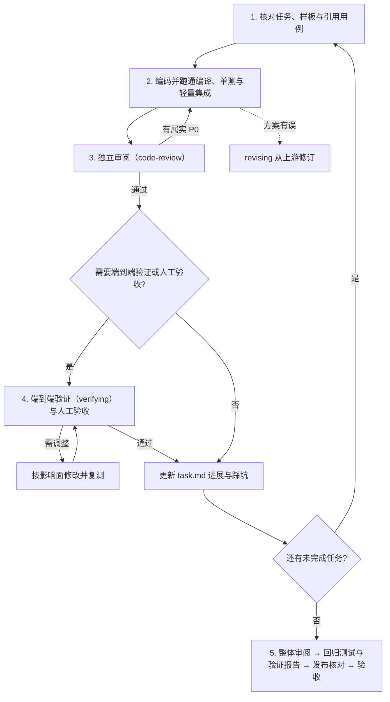

# 实施

每次实施都是对方案的检验。接口能力、依赖行为或性能不符合预期时，带着证据停下报告，必要时修订方案。

每项任务先跑通编译、单元测试和轻量集成测试，再交独立审阅；审阅通过后才做耗时的端到端测试和人工验收，免得审阅改了代码又要重测。任务多时，做完一项更新 `task.md` 并提交，可以换新会话继续下一项。

只有在第一项样板任务已经跑通、共用契约确定不变，剩下的是互不干扰或机械重复的任务时，才用 `dispatching-subagents` 派子代理执行；派单时指明 `task.md` 中对应的任务小节、已跑通的样板位置和复用清单。无论由当前会话还是子代理执行，都遵守下面同一套流程。

## 进入条件

读需求目录 `.rivo/issues/<slug>/`：`plan.md`、`test-plan.md`、`task.md`、`decisions.md`、`adr/`，以及已有的 `reviews/`、`evidence/` 和代码改动。

- `plan.md` 与 `test-plan.md` 均已定稿，且已拆出 `task.md`（若缺失，先提示用户是否回到 `writing-plans`）
- 用户已授权实施（推送、合并、发包或线上操作需单独授权）

继续已有目录时，先读 `task.md` 留下的进展、样板位置和实测结论，对照最新提交确定起点。

## 流程

### 1. 准备当前任务

开工前在会话里列好本任务的步骤（核对范围 → 编码与自动验证 → 独立审阅 → 按需做端到端验证和人工验收 → 更新 `task.md`）。动手前先读 `task.md` 指明的参照样板与复用清单，不放着现有组件重造轮子。

### 2. 编码与自动验证

- 行为与规则实现用 `test-driven-development`，预期优先取自本任务引用的 `TC-xx`（先写失败测试再写实现，再按实现细节补充边界测试）；纯数据库迁移、基建或静态排版不硬套测试驱动开发，跑对应迁移、编译或构建检查
- 排障定位用 `systematic-debugging`，临时脚本用完即删
- 只做当前任务需要的改动，不顺手加方案没要求的抽象或配置开关
- 送审前跑通静态检查（编译、类型检查、Lint）、单元测试与轻量集成测试；改跨仓接口或 SDK 消费方时必须过真实类型检查与构建，不用全 mock 代替集成验证

由子代理执行本步时，完成后返回改动文件、实测命令与输出以及新发现，由主会话统一安排审阅并更新 `task.md`。

### 3. 独立审阅

自动检查通过后，加载 `code-review`（单项模式）并行派两名独立审阅者，分别检查代码质量与规范、需求符合度与引用用例落地情况，汇总写入 `reviews/<任务>.md`：
- 属实的 P0 修完后重跑受影响的自动检查，交回对应审阅者复核，直到两个方向均通过
- 未修的 P1、P2 和拒绝理由记入 `task.md` 对应任务

### 4. 端到端验证与人工验收

- 如果本任务包含端到端测试用例或标为需要人工验收，加载 `verifying` 做页面或链路实测，截图与日志放 `evidence/<任务>/`
- 标为需要人工验收时，停下来请用户检查页面或业务流程；如果用户提出修改，按影响面定向调整、补上对应的自动测试，只复测受影响范围，确认后再继续
- 不需要人工验收的任务，或小需求全程自动推进时，在 `task.md` 记下进展、实测踩坑和引用用例的执行结果后直接进下一项

### 5. 整体回归、发布核对与验收

全部任务完成后按顺序收尾：

1. **整体审阅**：加载 `code-review`（整体模式）并行派两名独立审阅者审阅全部改动，汇总写入 `reviews/final-<n>.md`，属实的 P0 修完复核
2. **回归测试与验证报告**：加载 `verifying`，全量跑静态检查、单元测试和集成测试，再对跨模块主干、核心冒烟和受影响的老功能做端到端回归。项目接入了外部测试平台时，按项目约定同步执行。结果写入验证报告 `evidence/test-report.md`
3. **发布核对**：对照 `README`、`AGENTS.md`、CI 配置或知识库，核对分支、未提交文件、跨仓依赖（SDK 版本、lockfile 等）与发布授权边界

随后向用户交付并请最终验收，附四项说明：
- 实际改动与任务完成状态
- 整体审阅结论（`reviews/final-<n>.md`）与未修的 P1、P2
- 验证报告（`evidence/test-report.md`）与未覆盖范围
- 待执行的发布步骤与授权边界

用户明确验收通过后，加载 `knowledge-management` 更新知识库并归档。

## 实现与方案不一致时

| 情况 | 处理 |
| --- | --- |
| 任务内局部写法（不改行为、契约与测试预期） | 任务内决定并记入 `task.md` |
| `plan.md` 或 `test-plan.md` 契约、假设或回归范围有误 | 加载 `revising` 从受影响最上游修订；暂停依赖它的任务 |
| 底层模型或整体路子走不通 | 停下报告证据，确认后暂停或收尾当前需求，另开独立重构需求 |
