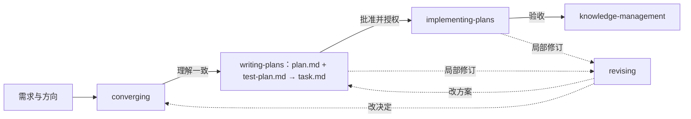

# 使用 Rivo

用户决定方向和重要取舍，AI 查清事实、提出建议，并按确认后的技术方案和测试方案完成开发与验证。文档保留决定的理由与验证证据，供团队评审和后续修改。

## 什么时候走 Rivo

由用户决定：
- 用户要求用 Rivo、点名某个 Rivo 技能，或继续已有需求目录：进入对应技能
- 其他请求，即使项目里有 `.rivo/`，也按普通方式处理
- 遇到明显的中大型需求，可以建议走 Rivo，用户确认后再进入

交付阶段按下表顺序衔接，进入下一阶段前需先获得对应的确认或授权；方法技能可以脱离交付流程独立使用，完成当前请求就结束。进入某个技能时，用一句话说明当前阶段和本次要做什么，同一项工作中不重复。

## 一次交付

| 阶段 | 技能 | 谁做什么、何时交接 | 结束于 |
| --- | --- | --- | --- |
| 讨论 | converging | AI 先问用户是否已有方向，查清代码现状与设计稿对应关系，逐轮请用户拍板决定、验收标准和不能改坏的老功能 | 用户确认理解一致 |
| 方案 | writing-plans | AI 依次写出技术方案 `plan.md` 与测试方案 `test-plan.md`，各找独立审阅者检查后交用户和团队评审；批准后立即拆出任务清单 `task.md` | 两份方案批准且 `task.md` 就绪 |
| 实施 | implementing-plans | AI 按任务改代码，先跑自动测试，再请未参与编码的人或代理审阅；需要用户检查页面或业务流程时停下来确认；全部做完后跑整体审阅、回归测试并交验证报告 | 用户最终验收 |
| 知识 | knowledge-management | AI 把核实过的系统机制、回归范围和环境注意事项合进项目知识库，并归档本次需求目录 | 知识更新、目录归档 |

已确认的决定、技术方案、测试方案或任务清单需要局部修改时，加载 `revising` 从受影响的最上游一层逐层改到代码。如果实施到中后期发现底层模型要推翻重做，先暂停或收尾当前需求，另开独立的重构需求。

方法技能不依赖 `.rivo/` 目录，在任何项目里都能单独使用，用完回到原任务。按大致的使用时机排列：

| 技能 | 做什么 |
| --- | --- |
| investigating | 查清代码现状、协议约束或设计稿与组件的对应关系，维护调查笔记 |
| system-design | 写精炼的技术方案并组织独立审阅 |
| test-design | 写分层测试方案和回归范围并组织独立审阅 |
| test-driven-development | 先写失败测试，再写实现 |
| systematic-debugging | 复现异常，用证据检验原因并验证修复 |
| dispatching-subagents | 安排独立调查、独立审阅，或样板定型后的批量委派 |
| code-review | 两名独立审阅者分别检查代码质量和需求符合度 |
| verifying | 从快到慢做分层验证和回归，写出验证报告 |

## 贯穿全程的约定

- **谁决定什么**：代码和配置能查明的事实由 AI 自己查，不拿去问用户。设计方案前，先询问用户是否已有方向思路；用户没有时才由 AI 先拟方案再一起讨论。范围、重要取舍和验收标准由用户决定，任务内的局部代码写法由执行者选择并记录
- **开发与测试合一**：不单设测试阶段，改代码的一方同时负责验证。测试预期在编码前随 `test-plan.md` 定下，自动测试先于代码审阅。大中型需求在 `task.md` 里标出需要人工验收的任务；小需求精简 `test-plan.md`，中途不打断，做完交用户一次验收
- **批准与授权**：沉默不算批准。批准方案不等于授权实施，用户可以一次给出两者。推送、合并、发布或线上操作需要相应授权，不从“完成需求”推导
- **分次实施与接力**：小需求可以在一个会话里做完；任务较多时，在两份方案和 `task.md` 定稿后，可以按任务分次开启新会话推进，靠 `task.md` 里记下的样板位置、实测结论和已提交的代码接力，不硬撑超长会话，也不盲目外包给无状态子代理
- **遵守项目规约**：编码规范、组件库、写作偏好、画图工具，以及外部测试平台（如果项目接入了）的用法，按目标项目的 `AGENTS.md`、`CLAUDE.md` 及当前环境可用工具执行。缺少子代理工具时，继续不依赖委派的工作并如实说明缺口，不把主会话自查算作独立审阅

## 产物与目录

材料默认放在目标项目的 `.rivo/issues/<slug>/`，用户或项目指定的位置优先。需求根目录只放下列入口文件，不把临时对比、自查汇总或一次性脚本留在根目录：

| 路径 | 内容 | 谁写 |
| --- | --- | --- |
| `decisions.md` | 范围、全部决定、验收标准与老功能回归范围、待决事项 | converging |
| `adr/` | 重要取舍及理由 | converging |
| `research/` | 按主题维护的调查笔记 | investigating |
| `plan.md`、`assets/` | 技术方案及其附件，给人读、给人评审 | system-design / writing-plans |
| `test-plan.md` | 按业务模块与回归范围组织的测试方案（`TC-xx`） | test-design / writing-plans |
| `task.md` | 合并两份方案后的任务清单、引用的用例编号、人工验收节点与实测记录 | writing-plans / implementing-plans |
| `evidence/` | 任务实测截图/日志、排障记录，以及最终验证报告 `test-report.md` | verifying / implementing-plans / investigating |
| `reviews/` | 审阅报告：`plan-<n>.md`、`test-plan-<n>.md`、`<任务>.md`、`final-<n>.md` | 各阶段的独立审阅者 |

一类产物只有一个位置。现状写进 `research/`，决定和理由写进 `decisions.md` 与 `adr/`，架构与边界写进 `plan.md`，测试用例与回归范围写进 `test-plan.md`，任务拆分和实测踩坑写进 `task.md`，最终验证汇总写进 `evidence/test-report.md`，互不搬运。

项目知识库默认在 `.rivo/knowledge/`（按系统域维护的 Wiki），验收后的需求目录移入 `.rivo/archived/`。
